# 🗝️ VR Escape Room — The Lost Relic

[-blue.svg?logo=unity)](https://unity.com/)
[-orange.svg)](https://unity.com/srp/universal-render-pipeline)
[](https://docs.unity3d.com/Packages/com.unity.xr.interaction.toolkit@latest)
[%20%2B%20Desktop%20Fallback-brightgreen.svg)]()
[](LICENSE)

An atmospheric, tactile VR escape-room adventure built in **Unity 6 (URP)**. Trapped inside an ancient 8×8m medieval stone chamber, you must explore the environment, decipher hidden astronomical and cryptic clues, solve a mechanical combination lock, retrieve the antique brass key from a locked relic chest, and unlock the exit door into the garden courtyard before the 5-minute timer expires.

---

## 🎮 Gameplay & Puzzle Sequence

The game features an interconnected puzzle sequence:

```mermaid
flowchart LR
    P1["1. Cold Awakening<br/>Stone chamber<br/>5:00 Timer begins"] --> P2["2. Celestial Star Journal<br/>Bookshelf (Shelf 3)<br/>Clue 1: Digit = 5"]
    P2 --> P3["3. Study Desk & Note<br/>Study table & chair<br/>Clue 2: Digit = 2"]
    P3 --> P4["4. Wall Inscription<br/>South masonry plaque<br/>Clue 3: Digit = 7"]
    P4 --> P5["5. Keypad Entry<br/>Enter passcode '5-2-7'<br/>on Relic Box"]
    P5 --> P6["6. Chest Unsealed<br/>Lid pivots open<br/>Brass Key revealed"]
    P6 --> P7["7. Working Key Socket<br/>Insert brass key into<br/>door lockplate"]
    P7 --> P8["8. Escape & Freedom<br/>Door swings open<br/>Patio courtyard -> VICTORY!"]
```



1. **Clue 1 — Celestial Star Journal** *(Bookshelf, Shelf 3)*:  
   *“Astronomer’s Note: The sacred star has 5 golden points.”* $\rightarrow$ **First Digit = 5**
2. **Clue 2 — Diary Scrap** *(Study Desk)*:  
   *“DIARY NOTE: How many eyes behold this room? How many ears listen in the dark?”* $\rightarrow$ **Second Digit = 2**
3. **Clue 3 — Chiseled Wall Inscription** *(South Wall)*:  
   *“Ancient Inscription: Seven days to walk the earth. Seven wonders of the old world.”* $\rightarrow$ **Third Digit = 7**
4. **Passcode & Relic Chest**:  
   Entering **`5 - 2 - 7`** on the 3×4 mechanical keypad unlocks the chest deadbolt, swinging the lid open to reveal the glowing antique brass key.
5. **Exit Door & Freedom**:  
   Inserting the brass key into the door's realistic keyhole socket triggers the latch, swinging the door 95° open into the sunlit garden patio and boundary-walled courtyard.

---

## ✨ Key Features

* **Dual Input System (VR + Desktop):**
  * **VR Mode:** Native OpenXR and XR Interaction Toolkit support with direct grab, ray interaction, and poke adaptors.
  * **Desktop FPS Mode:** Playable immediately inside the Unity Editor without an HMD. WASD movement, mouse look, crosshair raycasts, and interactive object grabbing.
* **Seamless Room Architecture:**
  * Precision-aligned 8×8×3.8m stone chamber with zero-gap wall seams, flush ceiling rafters, and perfectly cased exit doorway.
  * Continuous outdoor patio pavers, threshold step slab, lawn collider, and perimeter boundary walls preventing falls beyond the exit.
* **Natural Electric Bulb Lighting:**
  * Visible glowing bulbs with emissive materials and warm point lights (2700K–2900K) positioned directly within the fixtures (desk lamp, wall sconces, hanging ceiling pendant).
* **Realistic Exit Door & Key Socket:**
  * Polished brass escutcheon plate with a lever handle, raised brass bezel, and recessed dark keyhole cavity aligned with the interaction trigger.
* **Organized Book Rack:**
  * Varied upright tomes on Shelves 1, 2, and 3 sitting flush without clipping or floating; Clue 1 sits upright at eye level.
* **World-Space VR Canvas UI:**
  * Floating UI panels (Intro, HUD countdown timer, Clue Inspection Magnifier, All Clues Found banner, Toast notifications, Win / Lose / Pause screens).
  * Robust in-place restart mechanism on the **Play Again** button.
* **Automated Scene Builder & Verification Suite:**
  * Full procedural scene constructor (`EscapeRoomSceneBuilder.cs`) capable of generating the complete environment from code.
  * Comprehensive automated verifier (`EscapeRoomVerifier.cs`) checking all 8 targeted systems.

---

## 🕹️ Controls Reference

### Desktop (Keyboard & Mouse)

| Action | Control |
| :--- | :--- |
| **Move** | <kbd>W</kbd> <kbd>A</kbd> <kbd>S</kbd> <kbd>D</kbd> |
| **Look Around** | Mouse |
| **Inspect / Interact / Grab** | <kbd>Left Click</kbd> or <kbd>E</kbd> |
| **Drop Held Object** | <kbd>Right Click</kbd> |
| **Close Clue Magnifier** | <kbd>Space</kbd>, <kbd>E</kbd>, or <kbd>Left Click</kbd> |
| **Restart Game (Win / Lose)** | Click **PLAY AGAIN** or press <kbd>Space</kbd> / <kbd>Enter</kbd> / <kbd>R</kbd> |
| **Toggle Cursor Lock** | <kbd>Escape</kbd> |

### VR (XR Controllers)

| Action | Controller Input |
| :--- | :--- |
| **Continuous Move** | Left Thumbstick |
| **Snap / Smooth Turn** | Right Thumbstick |
| **Grab Objects / Books / Key** | Grip Trigger |
| **Press Keypad Buttons / UI** | Index Trigger or Direct Poke |

### Developer Debug Hotkeys (Play Mode)

| Hotkey | Action |
| :---: | :--- |
| <kbd>F1</kbd> | Auto-discover and register all 3 clues |
| <kbd>F2</kbd> | Auto-enter combination code `527` on keypad |
| <kbd>F3</kbd> | Instantly unlock and open relic chest |
| <kbd>F4</kbd> | Instantly unlock and open exit door |
| <kbd>F5</kbd> | Trigger instant victory |

---

## 📂 Project Structure

```
Escape-Room-VR/
├── Assets/
│   ├── Editor/
│   │   ├── EscapeRoomEditorMenu.cs       # Custom Editor menu utilities
│   │   └── EscapeRoomVerifier.cs       # Automated 8-point verification suite
│   ├── Scenes/
│   │   └── EscapeRoom.unity             # Primary playable game scene
│   ├── Scripts/
│   │   ├── Core/
│   │   │   ├── GameManager.cs           # State machine, clue registry, game reset
│   │   │   ├── ScoreManager.cs          # Score calculation and time speed bonus
│   │   │   ├── SoundManager.cs          # Procedural and clip-based audio feedback
│   │   │   └── TimerManager.cs          # 5-minute countdown clock
│   │   ├── Editor/
│   │   │   └── EscapeRoomSceneBuilder.cs# Master automated scene constructor
│   │   ├── Interaction/
│   │   │   ├── ChairController.cs      # Sit-down desk mechanic
│   │   │   ├── ClueInteraction.cs      # Clue inspection and score trigger
│   │   │   ├── IInteractable.cs        # Interaction interface
│   │   │   └── XRInteractableAdapter.cs# XR / Desktop interaction bridge
│   │   ├── Player/
│   │   │   └── VRDesktopTester.cs       # Dual VR / Desktop First-Person Controller
│   │   ├── Puzzle/
│   │   │   ├── BoxController.cs         # Relic chest lid animation & lock state
│   │   │   ├── DoorController.cs        # Door swing hinge & daylight activation
│   │   │   ├── DoorKeyholeTrigger.cs    # Key socket detection trigger
│   │   │   ├── EscapeZone.cs            # Exit threshold victory trigger
│   │   │   ├── KeyController.cs         # Brass key physics & grab behavior
│   │   │   ├── KeypadButton.cs          # 3x4 mechanical keypad button logic
│   │   │   └── KeypadController.cs      # Code validation (527) and LCD display
│   │   └── UI/
│   │       └── UIManager.cs             # World-space UI canvas management
│   └── TextMesh Pro/                    # Fonts, shaders, and materials
├── Packages/
│   ├── manifest.json                    # Package dependencies (URP, XR Interaction Toolkit, OpenXR)
│   └── packages-lock.json
├── ProjectSettings/                     # Unity engine settings & input axes
├── STORYBOARD.md                        # Complete 8-panel narrative design specification
└── .gitignore                           # Standard Unity gitignore (ignores Library, Temp, Logs, etc.)
```

---

## 🚀 Getting Started

### Prerequisites

* **Unity Version:** `Unity 6 (6000.5.1f1)` or newer Unity 6 LTS.
* **Render Pipeline:** Universal Render Pipeline (URP).
* **Packages:** XR Interaction Toolkit, OpenXR Plugin, TextMeshPro, Input System.

### Installation

1. Clone this repository:
   ```bash
   git clone https://github.com/ShreyaS-1hait/Escape-Room-VR.git
   ```
2. Open **Unity Hub** and click **Add** $\rightarrow$ select the cloned `Escape-Room-VR` folder.
3. Open the project using **Unity 6 (6000.5.1f1)**.
4. Navigate to `Assets/Scenes/` and double-click **`EscapeRoom.unity`**.
5. Press the **Play** button at the top of the Unity Editor to play immediately with keyboard and mouse or a connected VR headset.

### Automated Scene Rebuilding & Verification

* **To rebuild the entire scene from code:**  
  Go to the top menu bar in Unity: `Tools` $\rightarrow$ `VR Escape Room` $\rightarrow$ `Build Complete Escape Room`.
* **To run the full 8-point verification test suite:**  
  Go to: `Tools` $\rightarrow$ `VR Escape Room` $\rightarrow$ `Run All 8 Fixes Verification`.

---

## 📜 License

This project is open-source and available under the [MIT License](LICENSE).
